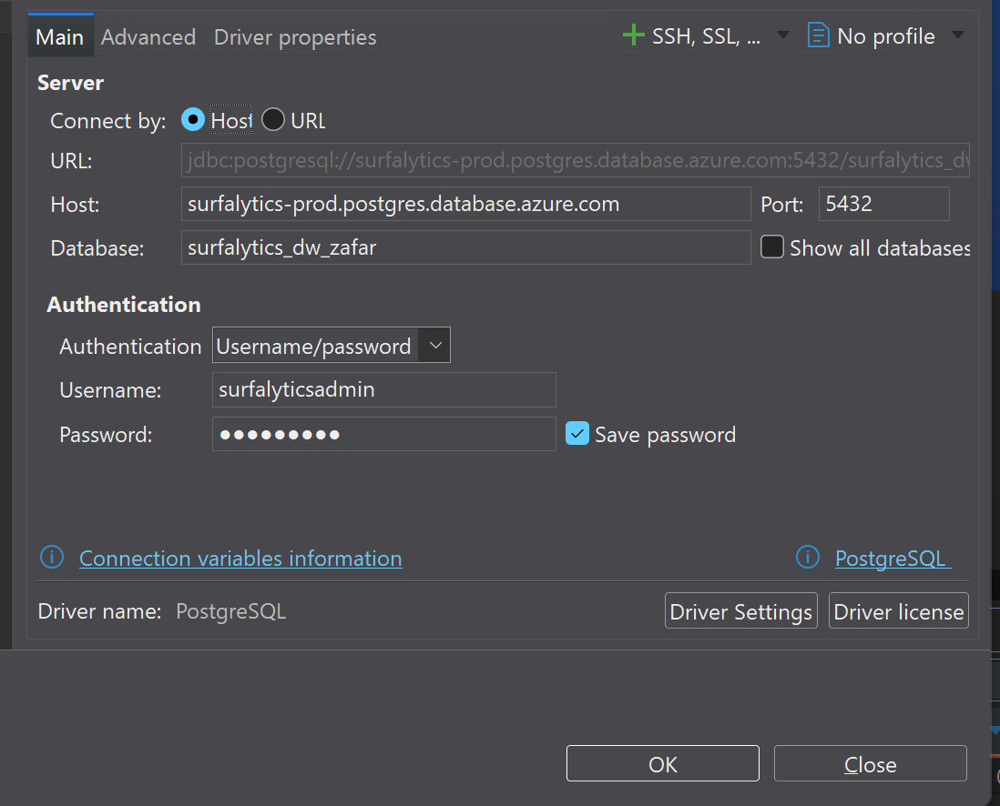
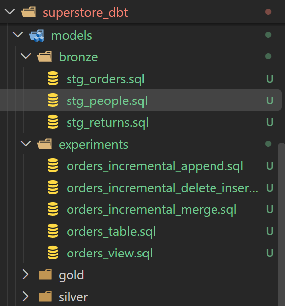
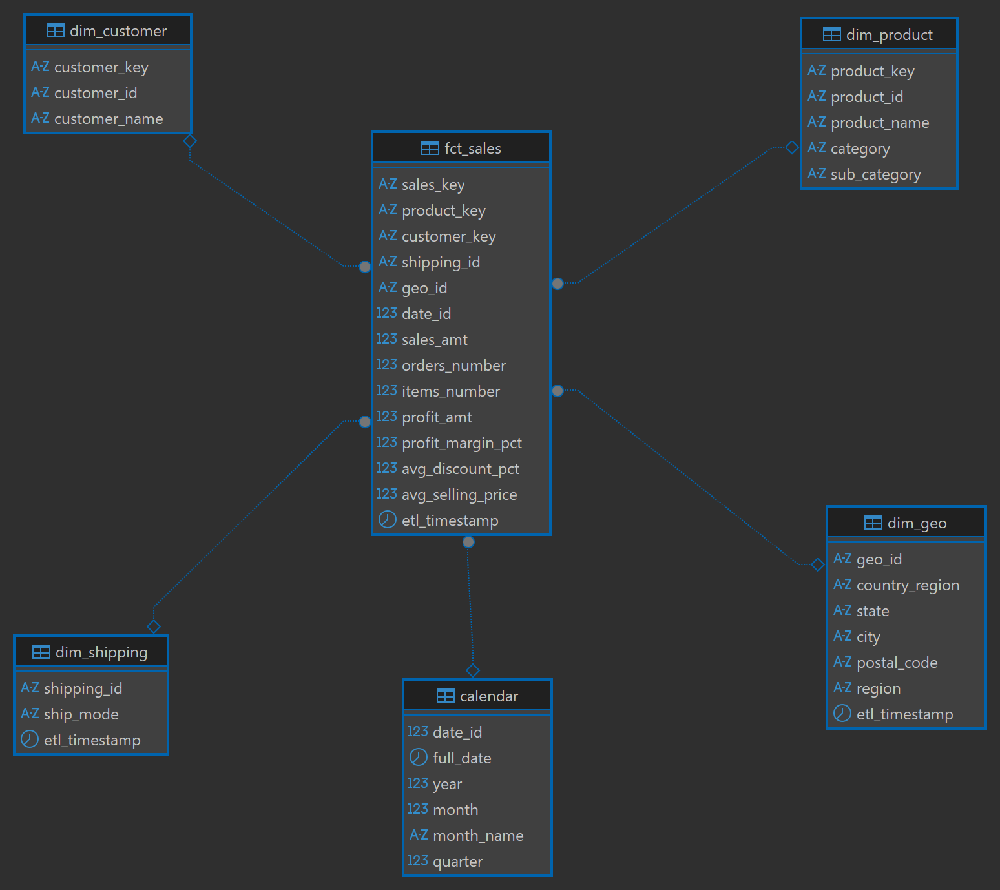

# End-to-end Analytics: dbt + Azure PostgreSQL + Looker

## Project Overview

This project is an end-to-end analytics engineering project built using dbt, Azure PostgreSQL, and Looker.

The goal is to build an anlytics workflow that transforms raw data into reliable analytical models and makes the resulting data available for reporting and visualization.

## Tech Stack

- Azure PostgreSQL
- dbt
- Looker
- SQL
- VSCode
- Git & GitHub

## Project Goals

- Work with data stored in Azure PostgreSQL
- Build data transformations using dbt
- Create reliable and maintainable analytical models
- Apply data quality testing and analytics engineering best practices
- Build dashboards and explore data using Looker
- Practice Git and GitHub workflows
- Build an end-to-end analytics engineering portfolio project

## Project steps

1. [Week 1](#week-1): Create new GitHub repo and clone into IDE using VSCode.
2. [Week 2](#week-2)
2. [Week 3](#week-3)

## Project Workflow

The planned workflow is:

Raw Data > Azure PostgreSQL > dbt Transformations > Analytical Models > Looker > Dashboards

## Week 1: Create a new repo and clone it using VScode

   - Clone the repo from Github

git clone https://github.com/Zofa777/dbt-azure-postgres-looker-analytics.git
- Create a README.md file

## Week 2: Load data into PostgreSQL using Dbeaver

1. Create a git folder **data** and put 3 files inside the folder.
2. Download appropriate version of [Dbeaver](https://dbeaver.io/download/) for your operation system
3. Click **Database** > **New Database** Connection  then choose **PostgreSQL**

4. Configure the connection:
 - Host : your-db-host
 - Port: 5432
 - Database: your-db-name
 - Username: your-db-user
 - Password: your-db-password

5. Click **Test Connection** to check if the connection details are correct then click **OK** to save it.


6. Create a database:
```sql
CREATE DATABASE SURFALYTICS_DW_YOURNAME;
```
7. Create a schema:
```sql
CREATE SCHEMA stg;
```
8. Create 3 tables and change column names into lower case so it could be more comfortable to work with columns:
```sql
 CREATE TABLE stg.orders (
    row_id INTEGER,
    order_id VARCHAR(50),
    order_date DATE,
    ship_date DATE,
    ship_mode VARCHAR(50),
    customer_id VARCHAR(50),
    customer_name VARCHAR(150),
    segment VARCHAR(50),
    country_region VARCHAR(100),
    city VARCHAR(100),
    state VARCHAR(100),
    postal_code VARCHAR(20),
    region VARCHAR(50),
    product_id VARCHAR(50),
    category VARCHAR(50),
    sub_category VARCHAR(100),
    product_name TEXT,
    sales NUMERIC(12, 2),
    quantity INTEGER,
    discount NUMERIC(5, 4),
    profit NUMERIC(12, 2)
);


CREATE TABLE stg.returns (
    returned VARCHAR(10),
    order_id VARCHAR(50)
);


CREATE TABLE stg.people (
    regional_manager VARCHAR(150),
    region VARCHAR(50)
);
```
7. Import CSV files into your database all files using mapping:
- Right click on table > Import Data > Import From CSV file(s)
- Choose appropriate file and finish

## Week 3 — dbt Core Setup and Staging Models

### Objective
Set up dbt Core with Azure PostgreSQL, create staging models, and configure separate development and production environments.

### Step 1 — Install and Initialize dbt Core

1. Create a Python virtual environment (`.venv`).
2. Activate the virtual environment.
3. Install `dbt-postgres` using pip.
4. Initialize a new dbt project named `superstore_dbt`.
5. Configure the PostgreSQL connection in `~/.dbt/profiles.yml`.
6. Run `dbt debug` to verify the connection.

### Step 2 — Configure dbt Sources

1. Create a `sources.yml` file inside the `models/` directory.
2. Define a source named `superstore`.
3. Specify the database `surfalytics_dw_zafar` and schema `stg`.
4. Declare three source tables: `orders`, `returns`, and `people`.
5. Run `dbt ls --resource-type source` to verify the source definitions.

### Step 3 — Create Staging Models

1. Create a `stg` folder inside the `models/` directory.
2. Create three SQL models:
   - `stg_orders.sql`
   - `stg_returns.sql`
   - `stg_people.sql`
3. Use the `source()` function to reference the corresponding PostgreSQL tables.
4. Configure each model as a view using `{{ config(materialized='view') }}`.
5. Run `dbt build --select path:models/stg` to build the staging models.

### Step 4 — Add Surrogate Keys and Timestamps

1. Create a `packages.yml` file in the dbt project directory.
2. Add the `dbt_utils` package.
3. Run `dbt deps` to install the package.
4. Use `dbt_utils.generate_surrogate_key()` to generate a `dwh_id` column in each staging model.
5. Add an `etl_timestamp` column using `CURRENT_TIMESTAMP`.
6. Rebuild the staging models to apply the changes.

**Note:** When using views, `CURRENT_TIMESTAMP` returns the query execution time rather than a stored data-loading timestamp.

### Step 5 — Configure DEV and PROD Environments

1. Open `~/.dbt/profiles.yml`.
2. Configure two targets:
   - `dev` — use the `dbt_dev` schema.
   - `prod` — use the `dbt_prod` schema.
3. Set `dev` as the default target.
4. Verify both connections:

   ```bash
   dbt debug --target dev
   dbt debug --target prod
   ```

5. Build the staging models in the production schema:

   ```bash
   dbt build --target prod --select path:models/stg
   ```

6. Open DBeaver and verify that the three staging views exist in both `dbt_dev` and `dbt_prod`.

### Step 6 — Configure Git Ignore

1. Create a `.gitignore` file in the repository root.
2. Add `.venv/` to exclude the Python virtual environment.
3. Exclude dbt-generated directories such as `target/`, `dbt_packages/`, and `logs/`.
4. Exclude `profiles.yml`, `.env` files, and Python cache files.
5. Run `git status` to verify which files Git detects.

### Step 7 — Commit and Push Week 3 Changes

1. Switch to the `week3` branch.
2. Update `README.md` with the Week 3 documentation.
3. Stage the project files using `git add`.
4. Review the staged files to ensure credentials and generated files are excluded.
5. Commit the changes with a descriptive message.
6. Push the `week3` branch to GitHub.
7. Create a Pull Request from `week3` into `main`.
8. Review and merge the Pull Request.

## Week 4 — Medallion Architecture & dbt Materializations

### 1. Medallion Architecture

Organized the dbt project into three layers:

- **Bronze:** Raw data staging and initial transformations.
- **Silver:** Data cleaning and intermediate transformations.
- **Gold:** Business-ready fact and dimension models.



Moved `stg_orders.sql`, `stg_people.sql`, and `stg_returns.sql` into the `models/bronze/` directory.

Configured Bronze models as views in `dbt_project.yml` and successfully compiled them.

```bash models:
  superstore_dbt:
       bronze:
      +materialized: view
```

### 2. Materialization Experiments

Created an `experiments/` folder to test different dbt materializations.

| Materialization | Model | Description |
|---|---|---|
| View | `orders_view.sql` | Stores a SQL query without physically storing the results |
| Table | `orders_table.sql` | Stores data physically and rebuilds on each run |
| Incremental | Three incremental models | Updates a physical table using a selected strategy |

Successfully executed the models using `dbt run` and verified the results in PostgreSQL.

### 3. Incremental Strategies

Implemented and tested three incremental strategies:

| Strategy | SQL operation | Behavior |
|---|---|---|
| Append | `INSERT INTO` | Adds incoming rows |
| Merge | `MERGE INTO` | Updates matching rows and inserts new ones |
| Delete+Insert | `DELETE` + `INSERT` | Replaces matching rows with incoming records |

Used `unique_key='row_id'` for Merge and Delete+Insert, and `is_incremental()` with `{{ this }}` to filter existing records in Append.

### 4. Pre-commit Hooks

Configured pre-commit to automate code-quality checks before Git commits.

Implemented four hooks:

- `check-yaml` — validates YAML syntax.
- `trailing-whitespace` — removes unnecessary spaces.
- `end-of-file-fixer` — ensures consistent file endings.
- `sqlfluff-lint` — checks SQL code using the PostgreSQL dialect and dbt templater.

Created `.pre-commit-config.yaml` and `.sqlfluff`.

Verified all checks using:

```bash
pre-commit run --all-files
```

**Result:** All four hooks passed successfully.

### 5. GitHub Actions — Continuous Integration

Created `.github/workflows/pre-commit.yml` to automate pre-commit checks when a pull request targets the `main` branch.

The workflow:

1. Checks out the repository.
2. Sets up Python and installs dependencies.
3. Installs dbt packages.
4. Runs all pre-commit checks.

Configured a CI-specific dbt profile in `.github/dbt/profiles.yml`, using environment variables and GitHub Secrets to manage Azure PostgreSQL credentials securely.

The CI profile uses the `dbt_ci` schema to separate future CI transformations from development and production.

## Week 5 — Advanced dbt: Testing, Documentation, Environments, and CI/CD

### Overview

During Week 5, I strengthened my Superstore dbt project by implementing development and production environments, automated data quality tests, unit tests, model documentation, metadata, and state-based deferral.

I also explored dbt artifacts, compiled SQL, execution logs, and code quality practices used in analytics engineering.

**Technology stack:** dbt Core 1.12.5, dbt-postgres 1.11.0, Azure PostgreSQL, SQL, YAML, Git, GitHub Actions, pre-commit, SQLFluff, WSL Ubuntu, and VS Code.

### 1. Configured DEV and PROD Environments

I configured separate development and production environments using dbt profiles.

- Configured DEV and PROD targets.
- Configured the `dbt_dev` and `dbt_prod` PostgreSQL schemas.
- Created separate `conf_local/` and `conf/` profile directories.
- Verified database connections using `dbt debug`.
- Practiced running models in both environments.
- Excluded local credentials from Git.

**Commands used:**

```bash
dbt debug --profiles-dir ./conf_local --target dev
dbt debug --profiles-dir ./conf --target prod

dbt run --profiles-dir ./conf_local --target dev
dbt run --profiles-dir ./conf --target prod
```

**What I learned:** How dbt profiles, targets, and database schemas support environment isolation.

### 2. Implemented Source Freshness Configuration

I explored source freshness monitoring and added a demonstration source named `freshness_demo`.

- Learned how dbt source freshness works.
- Configured `loaded_at` as the timestamp column.
- Configured a warning threshold of 1 hour.
- Configured an error threshold of 24 hours.

**Configuration:**

```yaml
- name: freshness_demo
  config:
    loaded_at_field: loaded_at
    freshness:
      warn_after:
        count: 1
        period: hour
      error_after:
        count: 24
        period: hour
```

**Command explored:**

```bash
dbt source freshness --profiles-dir ./conf_local --target dev
```

**What I learned:** How freshness checks help identify delayed source updates and how they differ from data quality tests.

*Final freshness execution status remains to be verified.*

### 3. Implemented Generic Data Tests

I added generic data tests to validate the quality of the Bronze models.

- Implemented `unique` tests.
- Implemented `not_null` tests.
- Implemented `accepted_values` tests.
- Implemented `relationships` tests.
- Added test definitions in `models/bronze/schema.yml`.
- Successfully executed the configured tests.

**What I learned:** How generic tests enforce reusable data quality constraints.

### 4. Implemented a Singular Data Test

I created a custom SQL test to validate positive order quantities.

**File created:**

`tests/assert_positive_order_quantity.sql`

- Created the singular test.
- Validated the order quantity rule.
- Executed the test successfully.

**What I learned:** How dbt singular tests identify records that violate custom business rules.

### 5. Implemented Unit Testing

I implemented a unit test for the Silver model `int_orders_cleaned`.

**File created:**

`models/silver/unit_tests.yml`

The transformation handles nonpositive quantities using:

```sql
CASE
    WHEN quantity <= 0 THEN 1
    ELSE quantity
END AS quantity
```

- Defined test inputs and expected results.
- Tested the quantity-cleaning logic.
- Successfully executed the unit test.

**What I learned:** How unit tests validate transformation logic independently of existing source data.

### 6. Reviewed dbt Version and Features

I checked the installed dbt versions:

- dbt Core: `1.12.5`
- PostgreSQL adapter: `1.11.0`

I also explored unit testing, a feature introduced in dbt Core 1.8, and used it in the project.

**Command used:**

```bash
dbt --version
```

**What I learned:** How dbt features evolve across versions and why adapter compatibility matters.

*Further upgrade and compatibility review remains optional follow-up work.*

### 7. Added Model Documentation

I documented the models and explored dbt's documentation capabilities.

**File created:**

`models/silver/orders_docs.md`

- Added model and column descriptions.
- Created reusable documentation blocks.
- Explored documentation generation and the dbt DAG.

**Commands explored:**

```bash
dbt docs generate --profiles-dir ./conf_local --target dev
dbt docs serve
```

**What I learned:** How centralized documentation improves maintainability and helps other developers understand transformation logic.

*Final generated-documentation verification is pending.*

### 8. Added Model Metadata

I explored model metadata and added information describing ownership, business domain, and architecture layer.

- Added model metadata.
- Explored metadata in dbt artifacts.

**What I learned:** How metadata supports model governance, discoverability, and maintainability.

### 9. Configured Model Tags, Aliases, and Materializations

I updated `dbt_project.yml` to configure the Bronze and Silver layers.

```yaml
models:
  superstore_dbt:
    bronze:
      +materialized: view
      +tags: ["bronze"]

    silver:
      +materialized: view
      +tags: ["silver"]
```

- Configured Bronze and Silver models as views.
- Added layer-specific tags.
- Configured the Silver model alias `orders_cleaned`.
- Preserved the Week 4 experimental models separately.

**What I learned:** How tags, aliases, and materializations help organize and manage dbt models.

### 10. Extended the Medallion Architecture

I continued developing the project's Medallion Architecture.

**Bronze layer:**

- `stg_orders.sql`
- `stg_people.sql`
- `stg_returns.sql`

**Silver layer:**

- `int_orders_cleaned.sql`

**Project structure:**

```text
models/
├── bronze/
│   ├── schema.yml
│   ├── stg_orders.sql
│   ├── stg_people.sql
│   └── stg_returns.sql
├── silver/
│   ├── int_orders_cleaned.sql
│   ├── orders_docs.md
│   └── unit_tests.yml
└── experiments/
```

**What I learned:** How Bronze and Silver layers separate source-aligned staging from cleaned and transformed data.

### 11. Explored the dbt DAG and Dependencies

I explored how dbt manages model dependencies using `source()` and `ref()`.

**Dependency structure:**

```text
stg.orders
    |
    v
stg_orders (Bronze)
    |
    v
int_orders_cleaned (Silver)
```

The Silver model references the Bronze model using:

```sql
FROM {{ ref('stg_orders') }}
```

**What I learned:** How dbt determines execution order and maintains dependencies between models.

### 12. Practiced Core dbt Commands

I practiced and compared the following commands:

| Command | Purpose |
|---|---|
| `dbt run` | Builds models |
| `dbt test` | Executes tests |
| `dbt build` | Builds resources and executes applicable tests |
| `dbt compile` | Generates compiled SQL |

I also practiced selecting individual models and working with specific environments.

**What I learned:** How to choose the appropriate dbt command for development, validation, and deployment.

### 13. Explored dbt Logs and Compiled SQL

I inspected dbt-generated files and execution logs.

- Explored `logs/dbt.log`.
- Inspected compiled SQL.
- Examined `target/compiled/`.
- Examined `target/run/`.
- Reviewed generated PostgreSQL statements.

**What I learned:** How dbt compiles Jinja-based SQL and how execution logs support debugging.

### 14. Explored dbt Artifacts

I explored the machine-readable artifacts generated by dbt.

**`manifest.json`**

Contains model definitions, configurations, dependencies, and project metadata.

**`run_results.json`**

Contains execution results, statuses, and timing information.

- Inspected model configurations and dependencies.
- Explored artifact structures.
- Learned how artifacts support state-based workflows.

**What I learned:** How dbt artifacts provide information for debugging, documentation, and CI/CD.

### 15. Practiced State-Based Deferral

I generated a production-configured manifest and used it to practice deferral.

**Generated the PROD manifest:**

```bash
dbt parse \
  --profiles-dir ./conf \
  --target prod \
  --target-path target_prod
```

**Practiced deferral:**

```bash
dbt compile \
  --select int_orders_cleaned \
  --profiles-dir ./conf_local \
  --target dev \
  --defer \
  --favor-state \
  --state target_prod
```

**Verified result:**

```sql
FROM "surfalytics_dw_zafar"."dbt_prod"."stg_orders"
```

This confirmed that the DEV Silver model could resolve an upstream dependency to the production Bronze relation.

- Generated the PROD manifest.
- Practiced `--state`.
- Practiced `--defer`.
- Practiced `--favor-state`.
- Verified the compiled SQL.

**What I learned:** How state-based deferral can reuse existing database relations during development.

A full Slim CI pipeline and `state:modified` workflow remain future enhancements.

### 16. Improved Repository Security and Code Quality

I continued using the code quality tooling introduced in Week 4.

- Configured pre-commit hooks.
- Added whitespace and YAML checks.
- Installed and practiced SQLFluff.
- Updated `.gitignore`.
- Excluded generated artifacts and local credentials.

**Final validation command:**

```bash
pre-commit run --all-files
```

**What I learned:** How automated code quality checks help prevent formatting and configuration issues.

Final Week 5 pre-commit validation and review of additional hooks are still pending.

### 17. Reviewed CI/CD and GitHub Workflow

I continued working with the GitHub Actions workflow introduced in Week 4.

- Created a pre-commit GitHub Actions workflow during Week 4.
- Practiced feature-branch development and pull requests in earlier weeks.

The remaining Week 5 work includes verifying the workflow, reviewing the PR template, and confirming the checks on the Week 5 pull request.

**What I learned:** How automated checks and pull requests support reliable analytics engineering workflows.

### 18. Validated Data Quality and Transformation Logic

I successfully executed the project's dbt tests against the DEV environment.

**Command executed:**

```bash
dbt test \
  --profiles-dir ./conf_local \
  --target dev
```

**Results:**

```text
7 data tests
1 unit test

PASS=8
WARN=0
ERROR=0
SKIP=0
TOTAL=8
```

All eight tests passed successfully.

### 19. Pre-commit and Code Quality

During Week 5, I expanded the pre-commit configuration from Week 4 by adding security, Git validation, and dbt-specific documentation checks.

**File:** `.pre-commit-config.yaml`

```yaml
repos:
  - repo: https://github.com/pre-commit/pre-commit-hooks
    rev: v5.0.0
    hooks:
      - id: check-yaml
      - id: trailing-whitespace
      - id: end-of-file-fixer
      - id: check-merge-conflict
      - id: check-added-large-files
        args: ['--maxkb=1000']
      - id: detect-private-key

  - repo: local
    hooks:
      - id: sqlfluff-lint
        name: SQLFluff lint
        entry: sqlfluff lint
        language: system
        types: [sql]
        pass_filenames: true

  - repo: https://github.com/dbt-checkpoint/dbt-checkpoint
    rev: v2.0.8
    hooks:
      - id: check-model-has-description
        files: ^superstore_dbt/models/bronze/.*\.sql$
        args:
          - --manifest
          - superstore_dbt/target/manifest.json
```

#### dbt-checkpoint Example

I added `check-model-has-description` to verify that Bronze models have documentation.

The hook initially failed because `stg_people` was missing a description. I added the following to `models/bronze/schema.yml`:

```yaml
- name: stg_people
  description: "Bronze model containing Superstore regional manager information"
```

I regenerated the manifest and reran the hook:

```bash
dbt parse --profiles-dir ./conf_local --target dev
pre-commit run check-model-has-description --all-files
```

**Result:**

```text
Check the model has description................Passed
```

#### Validation

I also ran:

```bash
pre-commit run --all-files
```

All seven general hooks passed. The dbt-checkpoint hook passed separately; final validation of all eight hooks together is pending.

**Key learning:** Pre-commit automates formatting, security, SQL linting, and dbt documentation checks, helping catch issues before code is committed to GitHub.


## Week 6 — Dimensional Modeling, Star Schema & Data Quality

### Overview

During Week 6, I expanded my end-to-end analytics project by implementing dimensional modeling using **dbt Core and Azure PostgreSQL**.

The main objective was to transform cleaned Superstore transactional data into analytics-ready fact and dimension tables following a **star schema architecture**.

The implementation includes:

- Creating and loading a calendar seed.
- Installing and managing additional dbt packages.
- Improving Bronze-layer data quality tests.
- Building Silver-layer transformations and joins.
- Creating four dimension tables and one fact table.
- Implementing surrogate keys and business metrics.
- Validating data quality and aggregation results.
- Generating dbt documentation and reviewing the DAG.
- Creating logical and physical star schema diagrams in DBeaver.

---

### 1. Calendar Seed

Created `superstore_dbt/seeds/calendar.csv` to learn how dbt seeds load static CSV files into a data warehouse.

The calendar contains **1,461 dates**, covering January 1, 2018, through December 31, 2021.

**Calendar columns:**

| Column | Description |
|---|---|
| `date_id` | Unique date identifier |
| `full_date` | Calendar date |
| `year` | Calendar year |
| `month` | Month number |
| `month_name` | Month name |
| `quarter` | Calendar quarter |

**Command executed:**

```bash
dbt seed --profiles-dir ./conf_local --target dev
```

**Result:** Successfully created the `dbt_dev.calendar` table in Azure PostgreSQL.

The calendar table supports date-based analysis and provides the date dimension for the Gold-layer star schema.

---

### 2. dbt Packages

Updated `packages.yml` and installed reusable dbt packages to support transformations, testing, and date operations.

| Package | Purpose |
|---|---|
| `dbt_utils` | Surrogate key generation and reusable utility macros |
| `dbt_expectations` | Advanced data quality testing |
| `dbt_date` | Date-related macros |

**Command executed:**

```bash
dbt deps
```

Package dependencies are defined in `packages.yml`, and resolved versions are recorded in `package-lock.yml`.

---

### 3. Bronze Layer — Data Quality Improvements

The Bronze layer contains three staging models:

- `stg_orders`
- `stg_people`
- `stg_returns`

These models standardize the original Superstore data loaded into Azure PostgreSQL.

Technical metadata includes:

- `dwh_id` — surrogate identifier generated using `dbt_utils.generate_surrogate_key()`.
- `etl_timestamp` — timestamp indicating when the transformation is executed.

Updated `models/bronze/schema.yml` to strengthen data quality validation, including uniqueness checks.

These tests help identify duplicate records and missing identifiers before data reaches downstream transformations.

---

### 4. Silver Layer — Data Cleaning and Enrichment

The Silver layer prepares detailed transactional data for analytical modeling.

| Model | Purpose |
|---|---|
| `int_orders_cleaned` | Cleans invalid quantities using conditional logic |
| `int_returns_deduplicated` | Deduplicates return records before joining |
| `int_orders_enriched` | Enriches orders with related business information |

The transformations use SQL joins, `CASE` expressions, surrogate keys, and ETL timestamps.

The Silver layer preserves transaction-level detail without aggregating sales metrics.

#### 4.1 Silver Layer Validation

| Metric | Result |
|---|---:|
| Order lines | 9,994 |
| Distinct orders | 5,009 |
| Items sold | 37,873 |
| Total sales | 2,297,201.07 |

These values provide the baseline for validating the Gold-layer aggregations.

---

### 5. Gold Layer — Dimensional Modeling

The Gold layer transforms detailed transactional data into a star schema designed for analytical queries and business intelligence.

Created four dimension tables and one fact table, materialized as PostgreSQL tables.

#### 5.1 Dimension Tables

| Dimension | Records | Description |
|---|---:|---|
| `dim_customer` | 793 | Customer identifiers and names |
| `dim_product` | 1,894 | Product identifiers, names, categories, and subcategories |
| `dim_shipping` | 4 | Shipping methods |
| `dim_geo` | 632 | Country/region, state, city, postal code, and region |

Surrogate keys were generated using `dbt_utils.generate_surrogate_key()`.

For `dim_product`, the surrogate key combines `product_id` and `product_name` because `product_id` alone does not uniquely identify every product record.

For `dim_geo`, the surrogate key combines five geographic attributes to distinguish geographic combinations.

#### 5.2 Fact Table — `fct_sales`

Created `fct_sales` to store aggregated sales metrics and references to the dimensions.

**Dimension keys:**

- `product_key`
- `customer_key`
- `shipping_id`
- `geo_id`
- `date_id`

**Business metrics:**

- `sales_amt`
- `orders_number`
- `items_number`
- `profit_amt`
- `profit_margin_pct`
- `avg_discount_pct`
- `avg_selling_price`

Additional technical columns include `sales_key` and `etl_timestamp`.

The fact table grain is one record per unique combination of product, customer, shipping method, geography, and order date.

#### 5.3 Gold Layer Validation

| Metric | Result |
|---|---:|
| Fact table records | 9,986 |
| Total sales | 2,297,201.07 |
| Total items sold | 37,873 |
| Total profit | 286,397.68 |

The sales and quantity totals reconcile with the Silver layer, confirming that aggregation preserves the underlying transactional totals.

---

### 6. Data Quality Testing

Implemented dbt tests across the Bronze, Silver, and Gold layers.

The tests include:

- **`not_null`** — verifies required fields contain values.
- **`unique`** — checks uniqueness of identifiers.
- **`relationships`** — validates references between fact and dimension tables.
- **`accepted_values`** — checks categorical values against allowed lists.
- **Custom data tests** — validate business rules.
- **Unit tests** — verify transformation logic using predefined inputs and expected outputs.

These checks help maintain reliable data throughout the transformation pipeline.

---

### 7. dbt Documentation and DAG

Generated updated dbt documentation and reviewed the directed acyclic graph (DAG).

**Commands executed:**

```bash
dbt docs generate --profiles-dir ./conf_local --target dev
dbt docs serve --profiles-dir ./conf_local --target dev
```

The DAG illustrates the transformation flow:

```text
Azure PostgreSQL Source Tables
             |
             v
       Bronze Layer
             |
             v
       Silver Layer
             |
             v
        Gold Layer
       /          \
Dimensions      fct_sales

Calendar Seed ---> Date Relationships
```

The DAG provides visibility into model dependencies and helps identify the impact of upstream changes.

---

### 8. Star Schema — Logical and Physical Models

Designed a star schema in DBeaver to visualize the relationships between the Gold-layer tables.

The architecture consists of:

- One fact table: `fct_sales`.
- Four dimension tables: `dim_customer`, `dim_product`, `dim_shipping`, and `dim_geo`.
- One calendar table: `calendar`.

#### 8.1 Logical Star Schema

The logical star schema illustrates how the fact table connects to the dimension tables through surrogate keys.

The fact table is positioned at the center, while the dimension tables surround it.

Virtual foreign-key relationships were configured in DBeaver to visualize the one-to-many relationships between dimensions and the fact table.



#### 8.2 Physical Star Schema

The physical model documents the implemented PostgreSQL tables, including their columns, data types, and key structure.
