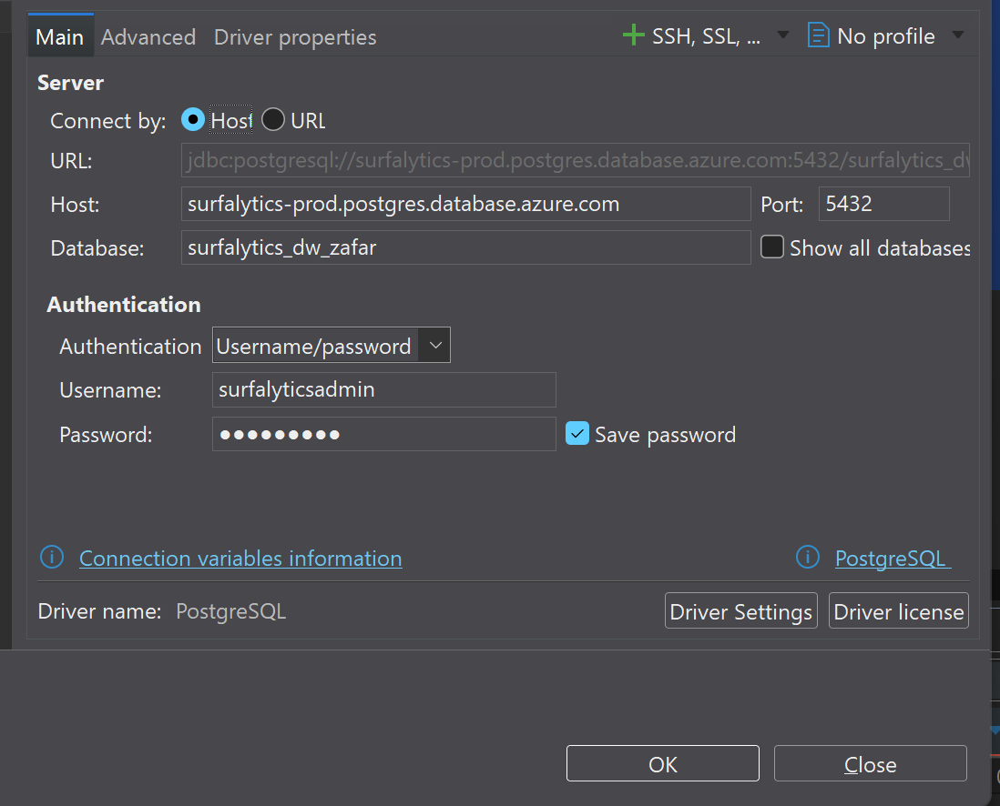
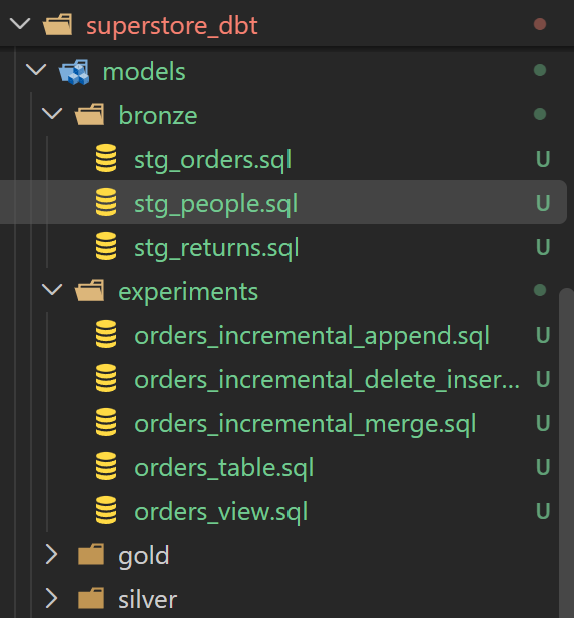

# End-to-end Analytics: dbt + Azure PostgreSQL + Looker

## Project Overview

This project is an end-to-end analytics engineering project built using dbt, Azure PostgreSQL, and Looker.

The goal is to build an anlytics workflow that transforms raw data into reliable analytical models and makes the resulting data available for reporting and visualization.

## Tech Stack

- Azure PostgreSQL
- dbt
- Looker
- SQL
- VSCode
- Git & GitHub

## Project Goals

- Work with data stored in Azure PostgreSQL
- Build data transformations using dbt
- Create reliable and maintainable analytical models
- Apply data quality testing and analytics engineering best practices
- Build dashboards and explore data using Looker
- Practice Git and GitHub workflows
- Build an end-to-end analytics engineering portfolio project

## Project steps

1. [Week 1](#week-1): Create new GitHub repo and clone into IDE using VSCode.
2. [Week 2](#week-2)
2. [Week 3](#week-3)

## Project Workflow

The planned workflow is:

Raw Data > Azure PostgreSQL > dbt Transformations > Analytical Models > Looker > Dashboards

## Week 1: Create a new repo and clone it using VScode

- Clone the repo from Github

git clone https://github.com/Zofa777/dbt-azure-postgres-looker-analytics.git
- Create a README.md file

## Week 2: Load data into PostgreSQL using Dbeaver

1. Create a git folder **data** and put 3 files inside the folder.
2. Download appropriate version of [Dbeaver](https://dbeaver.io/download/) for your operation system
3. Click **Database** > **New Database** Connection  then choose **PostgreSQL**

4. Configure the connection:
 - Host : your-db-host
 - Port: 5432
 - Database: your-db-name
 - Username: your-db-user
 - Password: your-db-password

5. Click **Test Connection** to check if the connection details are correct then click **OK** to save it.


6. Create a database:
```sql
CREATE DATABASE SURFALYTICS_DW_YOURNAME;
```
7. Create a schema:
```sql
CREATE SCHEMA stg;
```
8. Create 3 tables and change column names into lower case so it could be more comfortable to work with columns:
```sql
 CREATE TABLE stg.orders (
    row_id INTEGER,
    order_id VARCHAR(50),
    order_date DATE,
    ship_date DATE,
    ship_mode VARCHAR(50),
    customer_id VARCHAR(50),
    customer_name VARCHAR(150),
    segment VARCHAR(50),
    country_region VARCHAR(100),
    city VARCHAR(100),
    state VARCHAR(100),
    postal_code VARCHAR(20),
    region VARCHAR(50),
    product_id VARCHAR(50),
    category VARCHAR(50),
    sub_category VARCHAR(100),
    product_name TEXT,
    sales NUMERIC(12, 2),
    quantity INTEGER,
    discount NUMERIC(5, 4),
    profit NUMERIC(12, 2)
);


CREATE TABLE stg.returns (
    returned VARCHAR(10),
    order_id VARCHAR(50)
);


CREATE TABLE stg.people (
    regional_manager VARCHAR(150),
    region VARCHAR(50)
);
```
7. Import CSV files into your database all files using mapping:
- Right click on table > Import Data > Import From CSV file(s)
- Choose appropriate file and finish

## Week 3 — dbt Core Setup and Staging Models

### Objective
Set up dbt Core with Azure PostgreSQL, create staging models, and configure separate development and production environments.

### Step 1 — Install and Initialize dbt Core

1. Create a Python virtual environment (`.venv`).
2. Activate the virtual environment.
3. Install `dbt-postgres` using pip.
4. Initialize a new dbt project named `superstore_dbt`.
5. Configure the PostgreSQL connection in `~/.dbt/profiles.yml`.
6. Run `dbt debug` to verify the connection.

### Step 2 — Configure dbt Sources

1. Create a `sources.yml` file inside the `models/` directory.
2. Define a source named `superstore`.
3. Specify the database `surfalytics_dw_zafar` and schema `stg`.
4. Declare three source tables: `orders`, `returns`, and `people`.
5. Run `dbt ls --resource-type source` to verify the source definitions.

### Step 3 — Create Staging Models

1. Create a `stg` folder inside the `models/` directory.
2. Create three SQL models:
   - `stg_orders.sql`
   - `stg_returns.sql`
   - `stg_people.sql`
3. Use the `source()` function to reference the corresponding PostgreSQL tables.
4. Configure each model as a view using `{{ config(materialized='view') }}`.
5. Run `dbt build --select path:models/stg` to build the staging models.

### Step 4 — Add Surrogate Keys and Timestamps

1. Create a `packages.yml` file in the dbt project directory.
2. Add the `dbt_utils` package.
3. Run `dbt deps` to install the package.
4. Use `dbt_utils.generate_surrogate_key()` to generate a `dwh_id` column in each staging model.
5. Add an `etl_timestamp` column using `CURRENT_TIMESTAMP`.
6. Rebuild the staging models to apply the changes.

**Note:** When using views, `CURRENT_TIMESTAMP` returns the query execution time rather than a stored data-loading timestamp.

### Step 5 — Configure DEV and PROD Environments

1. Open `~/.dbt/profiles.yml`.
2. Configure two targets:
   - `dev` — use the `dbt_dev` schema.
   - `prod` — use the `dbt_prod` schema.
3. Set `dev` as the default target.
4. Verify both connections:

   ```bash
   dbt debug --target dev
   dbt debug --target prod
   ```

5. Build the staging models in the production schema:

   ```bash
   dbt build --target prod --select path:models/stg
   ```

6. Open DBeaver and verify that the three staging views exist in both `dbt_dev` and `dbt_prod`.

### Step 6 — Configure Git Ignore

1. Create a `.gitignore` file in the repository root.
2. Add `.venv/` to exclude the Python virtual environment.
3. Exclude dbt-generated directories such as `target/`, `dbt_packages/`, and `logs/`.
4. Exclude `profiles.yml`, `.env` files, and Python cache files.
5. Run `git status` to verify which files Git detects.

### Step 7 — Commit and Push Week 3 Changes

1. Switch to the `week3` branch.
2. Update `README.md` with the Week 3 documentation.
3. Stage the project files using `git add`.
4. Review the staged files to ensure credentials and generated files are excluded.
5. Commit the changes with a descriptive message.
6. Push the `week3` branch to GitHub.
7. Create a Pull Request from `week3` into `main`.
8. Review and merge the Pull Request.

## Week 4 — Medallion Architecture & dbt Materializations

### 1. Medallion Architecture

Organized the dbt project into three layers:

- **Bronze:** Raw data staging and initial transformations.
- **Silver:** Data cleaning and intermediate transformations.
- **Gold:** Business-ready fact and dimension models.



Moved `stg_orders.sql`, `stg_people.sql`, and `stg_returns.sql` into the `models/bronze/` directory.

Configured Bronze models as views in `dbt_project.yml` and successfully compiled them.

```bash models:
  superstore_dbt:
       bronze:
      +materialized: view
```

### 2. Materialization Experiments

Created an `experiments/` folder to test different dbt materializations.

| Materialization | Model | Description |
|---|---|---|
| View | `orders_view.sql` | Stores a SQL query without physically storing the results |
| Table | `orders_table.sql` | Stores data physically and rebuilds on each run |
| Incremental | Three incremental models | Updates a physical table using a selected strategy |

Successfully executed the models using `dbt run` and verified the results in PostgreSQL.

### 3. Incremental Strategies

Implemented and tested three incremental strategies:

| Strategy | SQL operation | Behavior |
|---|---|---|
| Append | `INSERT INTO` | Adds incoming rows |
| Merge | `MERGE INTO` | Updates matching rows and inserts new ones |
| Delete+Insert | `DELETE` + `INSERT` | Replaces matching rows with incoming records |

Used `unique_key='row_id'` for Merge and Delete+Insert, and `is_incremental()` with `{{ this }}` to filter existing records in Append.

### 4. SQL Verification

Inspected `logs/dbt.log` to examine the actual SQL generated by dbt.

Confirmed that all three strategies executed successfully against the Superstore dataset containing **9,994 records**.
